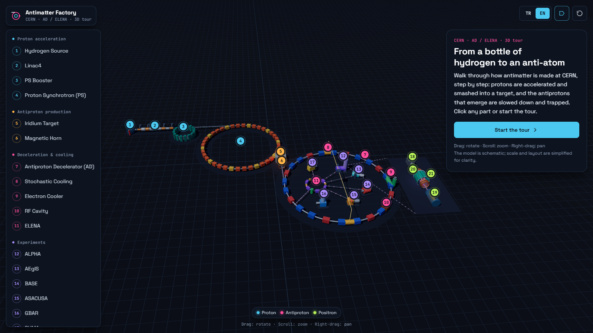
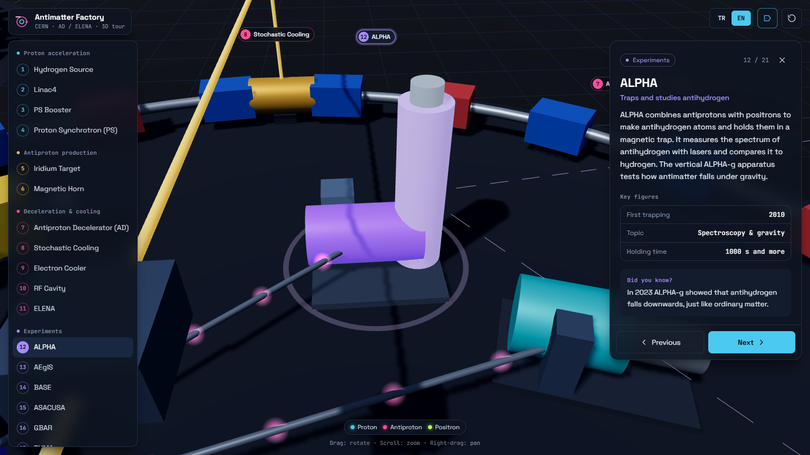

# Antimatter Factory · Interactive 3D Tour of CERN's AD / ELENA

An interactive 3D model of how antimatter is made at CERN, from a bottle of hydrogen gas to a trapped anti-atom. It follows the real chain: protons are accelerated, smashed into a target, and the antiprotons that come out are slowed down, cooled and handed to the experiments. The tour runs in the browser and is built with React, TypeScript, three.js, Vite and Tailwind. Turkish and English (TR | EN toggle in the header).

**Live:** https://pandakingpunc.github.io/antimatter-factory-3d/



## What you can do

- **Take the tour.** "Start the tour" walks through all 21 stations in order. Use Next / Previous or the ← → keys; Esc closes the panel.
- **Click any part**, in the scene or in the list on the left, to fly the camera to it and read what it does, its key figures and a short "did you know".
- **Move freely.** Drag to rotate, scroll to zoom, right-drag to pan. The reset button returns to the overview.
- **Toggle the labels** and switch the language at any time; the choice of language is remembered.



## The 21 stations

| Stage | Stations |
| --- | --- |
| Proton acceleration | Hydrogen Source, Linac4, PS Booster, Proton Synchrotron (PS) |
| Antiproton production | Iridium Target, Magnetic Horn |
| Deceleration and cooling | Antiproton Decelerator (AD), Stochastic Cooling, Electron Cooler, RF Cavity, ELENA |
| Experiments | ALPHA, AEgIS, BASE, ASACUSA, GBAR, PUMA |
| Trap lab (close-up) | Positron source, Penning trap, mixing trap, annihilation detector |

Moving particles are colour-coded: protons blue, antiprotons pink, positrons green.

## Simplifications

- The model is schematic. Scale, distances and the layout of the hall are simplified so that everything fits in one view; it is not an engineering drawing of the real facility.
- Machine shapes are stylised stand-ins, and the particle animation shows the route, not real beam dynamics.
- The texts and figures are short popular summaries. For the authoritative numbers, see [CERN's pages on the Antimatter Factory](https://home.cern/science/accelerators/antiproton-decelerator).
- This is an independent educational project and is not affiliated with or endorsed by CERN.

## Run it

Requires Node.js 20 or newer.

```bash
npm install
npm run dev
```

```bash
npm run build
```

The build produces a single self-contained file, `dist/index.html`, which can be opened directly or hosted anywhere. The interface fonts are loaded from Google Fonts; without a connection the page falls back to system fonts.

## Project layout

| Path | Contents |
| --- | --- |
| `src/data/parts.ts` | The 21 stations: positions, bilingual texts, key figures |
| `src/scene/createScene.ts` | three.js scene: machines, beam lines, particles, labels, camera |
| `src/App.tsx` | Interface: part list, info panel, tour, language toggle |

## Author

Mustafa Karatüm · [ORCID 0009-0006-7053-2872](https://orcid.org/0009-0006-7053-2872)

To cite this software, see [CITATION.cff](CITATION.cff).

## License

[MIT](LICENSE) © 2026 Mustafa Karatüm
